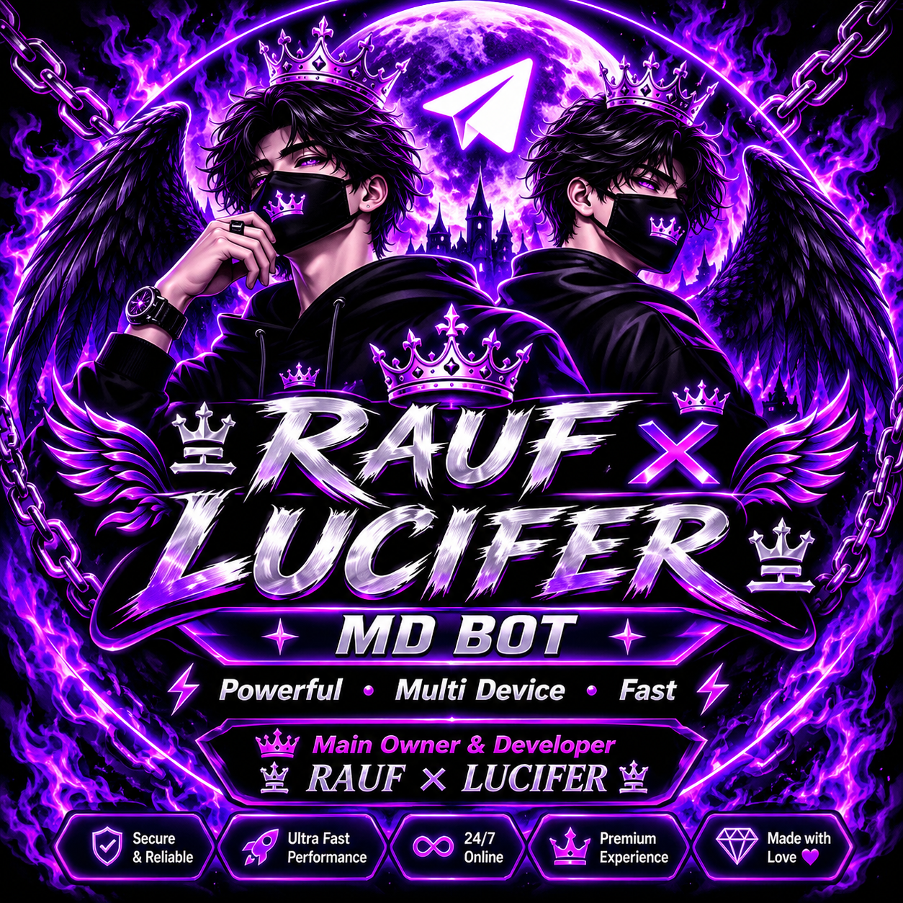

<!-- ===================================================== -->
<!--          RAUF × LUCIFER — PREMIUM README              -->
<!-- ===================================================== -->

<div align="center">

<!-- MAIN BANNER -->


<br/>


<br/>

**A NEXT-GENERATION WHATSAPP MULTI-DEVICE PROJECT**

<p>


</p>

<p>


</p>

<br/>

### 👑 MAIN OWNER & DEVELOPER

# RAUF

**OFFICIAL TEAM — RAUF × LUCIFER**

*Built with passion. Powered by innovation.*

</div>

---

## ◈ TABLE OF CONTENTS

- [About Project](#-about-project)
- [Project Vision](#-project-vision)
- [Features](#-features)
- [WhatsApp System](#-whatsapp-system)
- [Web Control Panel](#-web-control-panel)
- [Telegram Integration](#-telegram-integration)
- [Admin System](#-administration-system)
- [API Integrations](#-api-integrations)
- [Installation](#-installation-guide)
- [Configuration](#-configuration)
- [Deployment](#-deployment)
- [Security](#-security--privacy)
- [Troubleshooting](#-troubleshooting)
- [Contributing](#-contributing)
- [Credits](#-developer--credits)

---

## 💜 ABOUT PROJECT

**RAUF × LUCIFER MD BOT** is an advanced WhatsApp Multi-Device automation project developed by **RAUF**.

The project focuses on bringing together WhatsApp automation, account linking, session management, administrative tools, external API integrations and web-based management into one ecosystem.

Our objective is to build a modern, customizable and reliable automation experience with a premium user interface.

<div align="center">

### THE POWER OF AUTOMATION

**ONE PROJECT • MULTIPLE CAPABILITIES • ONE ECOSYSTEM**

</div>

---

## 🎯 PROJECT VISION

Our vision is to develop a flexible and modern bot platform.

- Advanced automation architecture.
- Multi-Device connectivity.
- Convenient account linking.
- Session management.
- Customizable bot identity.
- Administrative controls.
- Web-based management.
- External API connectivity.
- Better user experience.
- Continuous improvements.

---

## ⚡ FEATURES

<div align="center">

| ⚙️ FEATURE | ✨ DESCRIPTION |
|:---|:---|
| WhatsApp MD | Multi-Device architecture |
| Pairing System | Number-based account linking |
| Multi-Session | Multiple session management |
| Admin Controls | Administrative permissions |
| Owner System | Owner-level management |
| Telegram | Telegram integration |
| Force Join | Membership verification |
| Web Panel | Browser-based interface |
| API Integration | External API connectivity |
| Custom Branding | Custom bot identity |
| Support System | Support interface |
| Privacy Pages | Privacy and cookie documentation |

</div>

*Availability depends on the installed release and its configuration.*

---

## 📱 WHATSAPP SYSTEM

The WhatsApp system is designed around a Multi-Device architecture.

### Main Capabilities

- WhatsApp account connection.
- Pairing-code workflow.
- Session management.
- Automated command processing.
- Group and user utilities where implemented.
- Administrative functionality.
- Custom bot configuration.
- Supported plugin integrations.

### 🔗 ACCOUNT LINKING

The account-linking workflow is designed to guide users through the connection process.

1. Open the available pairing interface.
2. Select the available server.
3. Select the country.
4. Enter the WhatsApp number.
5. Request a pairing code.
6. Complete linking through WhatsApp.

**Security:** Never share your WhatsApp session credentials with unauthorized people.

---

## 🌐 WEB CONTROL PANEL

The project includes a browser-based management interface.

### Web Interface Components

- WhatsApp linking interface.
- Server selection.
- Country and phone-number selection.
- Custom bot name.
- Custom bot logo.
- Support interface.
- AI support agent.
- Administrative interface.
- Session-related operations.

### Documentation

| PAGE | PURPOSE |
|:---|:---|
| Privacy Policy | Privacy information |
| Cookie Policy | Cookie information |
| Pairing Interface | Account linking |
| Support | Assistance and information |

---

## 🤖 TELEGRAM INTEGRATION

Telegram integration extends the project's management ecosystem.

Supported integration areas may include:

- Telegram bot commands.
- Administrative notifications.
- Membership verification.
- Support workflows.
- Management interactions.

Actual availability depends on the configured Telegram modules.

---

## 👑 ADMINISTRATION SYSTEM

The administration system is designed to provide controlled access.

### Management Categories

- Owner permissions.
- Admin permissions.
- User management.
- Group management.
- Session management.
- Bot configuration.
- Membership verification.
- Administrative notifications.

Only authorized accounts should receive elevated permissions.

---

## 🔌 API INTEGRATIONS

External APIs can extend the functionality of the project.

### API Architecture

- External endpoint connectivity.
- Request and response handling.
- Configurable integrations.
- Error handling.
- Service availability checks.

Public API integrations should retain their original attribution and documentation.

**IMPORTANT:** Never publish private API keys, access tokens or authentication secrets.

---

## 💻 TECHNOLOGY & REQUIREMENTS

The exact runtime and dependencies must match the current repository source.

General requirements:

- Compatible runtime.
- Git.
- Internet connectivity.
- Required dependencies.
- Configured environment variables.
- Compatible hosting environment.

Use the dependency and startup files included in the actual project rather than assuming a different runtime.

---

## 📥 INSTALLATION GUIDE

### 01 — Clone Repository

```bash
git clone https://github.com/Rauf-ctrl/RAUF-X-LUCIFER-MD-BOT.git
```

### 02 — Open Project Directory

```bash
cd RAUF-X-LUCIFER-MD-BOT
```

### 03 — Install Dependencies

Use the installation command corresponding to the actual dependency file.

For Python projects with `requirements.txt`:

```bash
pip install -r requirements.txt
```

For Node.js projects with `package.json`:

```bash
npm install
```

### 04 — Environment Configuration

Configure the variables required by your installed release.

Keep sensitive values private.

### 05 — Start Application

Use the actual entry point and startup command provided by the project.

Verify the application logs after startup.

---

## ⚙️ CONFIGURATION

Review the available configuration files before deployment.

| SETTING | PURPOSE |
|:---|:---|
| Owner | Owner identification |
| Admins | Authorized administrators |
| Bot Name | Custom identity |
| Telegram | Telegram configuration |
| API | External integrations |
| Session | Account connection |
| Server | Hosting configuration |
| Force Join | Membership verification |

Only configure options supported by the installed version.

---

## 🚀 DEPLOYMENT GUIDE

General deployment workflow:

1. Prepare a compatible hosting environment.
2. Clone or upload the repository.
3. Install the required dependencies.
4. Configure environment variables.
5. Verify external services.
6. Configure secure access.
7. Start the application.
8. Check application logs.
9. Test the available interfaces.
10. Verify session and management functionality.

For production deployments, use HTTPS and protect administrative interfaces.

---

## 🔐 SECURITY & PRIVACY

Security is an important part of the project.

### Security Recommendations

- Protect WhatsApp session credentials.
- Never expose Telegram tokens.
- Never publish private API keys.
- Restrict administrative permissions.
- Use HTTPS for web interfaces.
- Validate external inputs.
- Keep dependencies updated.
- Exclude `.env` and secret files from Git commits.
- Review access to administrative endpoints.

### Privacy Documentation

The project includes documentation areas for:

- Privacy Policy.
- Cookie Policy.
- Account Linking.
- Service Information.
- Support Information.

Users should review the applicable policies before using the service.

---

## 📂 PROJECT STRUCTURE

The actual structure depends on the current release.

An illustrative structure:

```text
RAUF-X-LUCIFER-MD-BOT/
│
├── assets/
│   └── rauf-lucifer-banner.png
│
├── public/
│   ├── HTML
│   ├── CSS
│   └── JavaScript
│
├── plugins/
├── config/
│
├── README.md
├── .gitignore
└── dependency files
```

This is a documentation example, not a complete source-file listing.

---

## 🧩 COMMAND SYSTEM

The command system depends on the installed modules.

### Command Categories

| CATEGORY | PURPOSE |
|:---|:---|
| General | General utilities |
| AI | AI-related functions |
| Group | Group management |
| Admin | Administrative commands |
| Owner | Owner-level commands |
| Utility | Useful tools |
| Information | Information commands |
| Automation | Automation functions |

Refer to the actual bot menu for available commands.

---

## 🛠️ TROUBLESHOOTING

<details>
<summary><b>Dependency installation errors</b></summary>

Check the runtime version and dependency compatibility. Verify the dependency file before installing.

</details>

<details>
<summary><b>Pairing problems</b></summary>

Verify the server connection, account number and pairing workflow. Never share session credentials.

</details>

<details>
<summary><b>Telegram integration problems</b></summary>

Review Telegram configuration, bot permissions and network connectivity.

</details>

<details>
<summary><b>Web panel problems</b></summary>

Check application logs, environment configuration and HTTPS settings.

</details>

<details>
<summary><b>API connection problems</b></summary>

Verify endpoint availability, request formatting and service responses.

</details>

---

## 🤝 CONTRIBUTING

Contributions and suggestions are welcome.

1. Review the existing source.
2. Keep changes compatible with the project.
3. Do not expose credentials.
4. Test modifications.
5. Submit a clear description of your changes.

Help us improve the project responsibly.

---

## ⚖️ DISCLAIMER

This project is intended for educational, development and authorized automation purposes.

- Use the software responsibly.
- Follow WhatsApp and Telegram policies.
- Do not use it for spam or unauthorized activities.
- Protect your personal account and credentials.
- Respect user privacy.
- The developer is not responsible for misuse of the software.

---

## 👨‍💻 DEVELOPER & CREDITS

<div align="center">


<br/><br/>

# 亗 RAUF × LUCIFER 亗

### OFFICIAL DEVELOPMENT TEAM

**MAIN OWNER & DEVELOPER — RAUF**

*Creating • Developing • Improving*

</div>

---

## 🌟 SUPPORT THE PROJECT

If you find this repository useful:

- ⭐ Star the repository.
- 🔄 Share the project.
- 🐛 Report reproducible bugs.
- 💡 Suggest improvements.
- 🤝 Contribute responsibly.

<div align="center">

<a href="https://github.com/Rauf-ctrl/RAUF-X-LUCIFER-MD-BOT">

</a>

<br/><br/>

### PROJECT STATISTICS


<br/><br/>

### GITHUB CONTRIBUTION ACTIVITY


<br/>

### GITHUB PROFILE


<br/><br/>


<br/><br/>


<br/>

# 亗 𝐏𝐎𝐖𝐄𝐑𝐄𝐃 𝐁𝐘 𝐑𝐀𝐔𝐅 × 𝐋𝐔𝐂𝐈𝐅𝐄𝐑 亗

**© 2026 RAUF × LUCIFER — ALL RIGHTS RESERVED**

</div>
